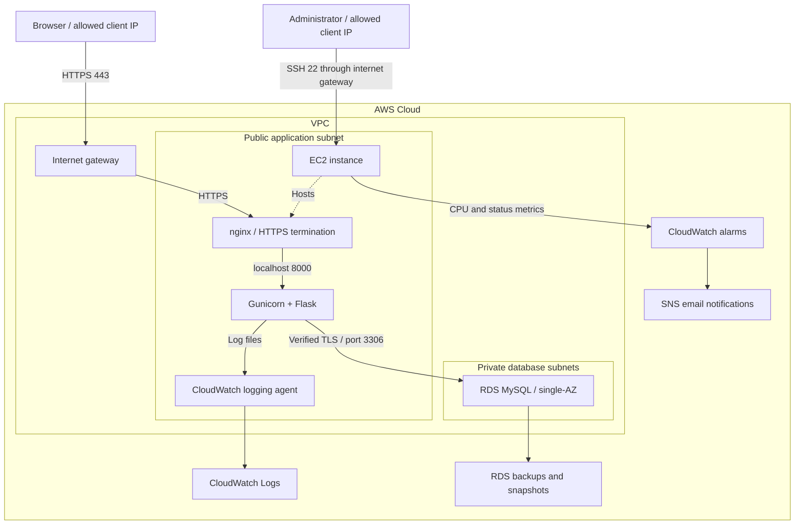

# CloudDesk — Cloud-Based Service Request Management

CloudDesk is a Flask-based service desk application built as a hands-on cloud engineering portfolio project. It provides a central workspace for raising service requests, assigning responsibility, tracking progress and recording communication.

The application runs locally with SQLite and includes Terraform configuration and deployment scripts for hosting on AWS EC2 with a private RDS MySQL database.

**Tech stack:** Python · Flask · SQLAlchemy · SQLite/MySQL · Docker · Terraform · AWS

**Start here:** [Local setup](docs/LOCAL_SETUP.md) · [AWS deployment](docs/AWS_DEPLOYMENT.md) · [Architecture](docs/ARCHITECTURE.md) · [Backup and recovery](docs/BACKUP_RECOVERY.md)

> **Project status:** The application passed 12 local automated tests. AWS deployment, live RDS integration, Docker execution and cloud recovery remain to be validated.

## Project Overview

Internal service requests often become scattered across emails, messages and spreadsheets. CloudDesk organizes each request into a ticket with a clear owner, priority, status, conversation and activity history.

Example requests include:
- VPN and software access.
- Laptop maintenance.
- Software installation.
- Network connectivity issues.

Requesters can create and track their own tickets. Administrators can review all requests, assign tickets to administrators and update their status.

## Features

- **Authentication:** Registration, login and hashed passwords.
- **Role-based access:** Requesters access their own tickets; administrators manage all tickets.
- **Ticket management:** Create requests with a title, description, category and priority.
- **Assignment and status:** Assign administrators and track Open, In Progress, Resolved and Closed tickets.
- **Comments and history:** Keep conversations and timestamped activity records with each ticket.
- **Dashboard:** View ticket counts and recent activity within the user's access scope.
- **Search and reporting:** Search, filter, paginate and export tickets to CSV.
- **Application protection:** CSRF protection, input validation, login throttling and security headers.
- **Concurrent updates:** Optimistic locking prevents stale administrative updates from silently overwriting newer changes.
- **Health checks:** Separate application liveness and database readiness endpoints.
- **Deployment support:** Docker configuration, AWS infrastructure and installation scripts.
- **Test automation:** GitHub Actions workflow for running Python tests.

## Architecture

### AWS Deployment Design

The following diagram shows the intended AWS deployment defined by the Terraform configuration and deployment scripts.



### How the Components Work Together

1. The user accesses the application through HTTPS.
2. nginx terminates HTTPS and forwards requests to Gunicorn on the EC2 instance.
3. Flask handles authentication, authorization and ticket workflows.
4. SQLAlchemy reads and writes application data in RDS MySQL.
5. The CloudWatch agent forwards application and server logs.
6. CloudWatch alarms send infrastructure alerts through SNS.
7. RDS backups and snapshots support database recovery.

### Network and Access Controls

- EC2 accepts inbound HTTPS and SSH only from the configured client IPv4 `/32`.
- Gunicorn listens on `127.0.0.1:8000`, behind nginx.
- RDS is not publicly accessible.
- The database security group accepts MySQL traffic only from the application security group.
- The private database subnets have no internet route.
- Database connections use verified TLS.
- The EC2 instance role provides permissions for publishing project logs.

The database subnet group spans two availability zones, but the RDS instance is **single-AZ**. This configuration does not provide Multi-AZ failover, load balancing or autoscaling.

### Deployment Modes

| Mode | Application Runtime | Database |
| --- | --- | --- |
| Local development | Flask development server | SQLite |
| Local Docker | Gunicorn inside a container | SQLite in a named volume |
| AWS deployment design | nginx and Gunicorn on EC2 | Private RDS MySQL |

The AWS installation scripts run the Python application directly on EC2 under systemd. Docker is provided as an alternative local execution workflow.

## Application Workflow

1. A requester registers and signs in.
2. The requester creates a ticket with the issue details.
3. An administrator reviews the ticket and assigns responsibility.
4. The administrator updates its priority or status.
5. Both users add comments to document progress.
6. The administrator marks the ticket Resolved or Closed.
7. The requester can review the activity history and export their tickets.

Authorization is enforced on the server for ticket pages, comments and exports.

## Quick Local Start

### Requirements

- Python 3.12 recommended.
- Git or an extracted copy of the project.
- A terminal such as Windows PowerShell.

No AWS account is required to run the application locally.

### Windows PowerShell

Run these commands from the project root:

```powershell
py -3.12 -m venv .venv
.\.venv\Scripts\python.exe -m pip install -r requirements-dev.txt
.\.venv\Scripts\python.exe scripts/bootstrap.py
.\.venv\Scripts\python.exe -m flask --app wsgi init-db
.\.venv\Scripts\python.exe -m flask --app wsgi create-admin
.\.venv\Scripts\python.exe -m flask --app wsgi seed-demo
.\.venv\Scripts\python.exe -m flask --app wsgi run
```

Open http://127.0.0.1:5000.

Sign in using the administrator account you created. There are no default passwords.

Use **Register** to create a requester account and compare the two roles.

- `bootstrap.py` creates local configuration with a random session secret.
- `init-db` creates the initial database tables.
- `create-admin` prompts for administrator credentials.
- `seed-demo` optionally adds sample tickets.

### Docker

Create your `.env` file using `python scripts/bootstrap.py`, then run:

```bash
docker compose build
docker compose run --rm web flask --app wsgi init-db
docker compose run --rm web flask --app wsgi create-admin
docker compose run --rm web flask --app wsgi seed-demo
docker compose up -d
```

Open http://127.0.0.1:8000.

SQLite data is stored in a named Docker volume. Running `docker compose down` preserves it; adding `-v` deletes the volume.

## AWS Deployment

Follow [docs/AWS_DEPLOYMENT.md](docs/AWS_DEPLOYMENT.md) for the complete instructions.

The deployment has two stages:

1. **Provision infrastructure** using Terraform.
2. **Install and configure the application** on EC2 using the supplied scripts.

The Terraform configuration includes:

- VPC and an internet gateway.
- One public application subnet and two private database subnets.
- Application and database security groups.
- EC2 instance with an IAM logging role.
- Encrypted RDS MySQL with seven-day automated backup retention.
- CloudWatch log group and infrastructure alarms.
- SNS email subscription.

Copy `infra/terraform.tfvars.example` to `infra/terraform.tfvars` and configure the required values before running:

```bash
cd infra
terraform init
terraform fmt
terraform validate
terraform plan
terraform apply
```

Review the plan before confirming deployment. Terraform provisions infrastructure; it does not automatically upload the source or complete application setup.

**AWS resources may incur charges.** Follow the deployment guide's cleanup instructions after testing.

## Monitoring and Recovery

- Application and Gunicorn logs can be forwarded to CloudWatch.
- The CloudWatch log group retains logs for 14 days.
- CPU and EC2 status-check alarms publish notifications through SNS.
- `/health/live` checks application responsiveness.
- `/health/ready` checks database connectivity.
- RDS configuration includes automated backups, deletion protection and a final snapshot.
- A manual snapshot script and recovery runbook are included.

The EC2 alarms monitor infrastructure health; they do not provide application-level HTTP uptime monitoring.

See [docs/BACKUP_RECOVERY.md](docs/BACKUP_RECOVERY.md) for restoration and verification steps.

## Security

- Hashed passwords and authenticated sessions.
- Server-side requester and administrator access checks.
- CSRF protection and input validation.
- Login and registration rate limits.
- HTML escaping and CSV formula escaping.
- Secure cookie settings for production HTTPS.
- Private database networking and encrypted database storage.
- A restricted runtime database account.

Never commit `.env`, passwords, private SSH keys or Terraform state files. Use `.env.example` and `terraform.tfvars.example` as configuration references.

## Project Structure

| Path | Purpose |
| --- | --- |
| `app/` | Application factory, models, forms and routes |
| `app/templates/` | Jinja HTML templates |
| `app/static/` | Application styles |
| `tests/` | Functional, authorization, security and local recovery tests |
| `infra/` | Terraform AWS resources and example variables |
| `scripts/` | Local setup, EC2 installation, RDS setup and logging helpers |
| `docs/` | Setup, architecture, validation and recovery guides |
| `.github/workflows/` | Automated test workflow |
| `Dockerfile` | Container image configuration |
| `compose.yaml` | Local container runtime configuration |
| `wsgi.py` | Application entry point |

## Testing

Run the test suite from the project root:

```powershell
.\.venv\Scripts\python.exe -m pytest -q
```

The initial local test run completed with **12 passing tests** covering authentication, access restrictions, ticket updates, stale-update conflicts, comment escaping, CSV filtering, CSRF, security headers, CLI setup and a SQLite backup round trip.

The GitHub Actions workflow runs Python tests on pushes and pull requests. It does not deploy the application.

See [docs/VALIDATION.md](docs/VALIDATION.md) for the checks performed and remaining validation work.

## Current Limitations

This is a learning and portfolio application.

- Live AWS deployment, RDS integration, Docker execution and RDS restoration remain unvalidated.
- The AWS design uses one EC2 instance and a single-AZ RDS database.
- The application uses one Gunicorn worker with threads.
- Rate limiting is process-local; multiple workers or replicas require shared storage.
- Activity history is application-level and is not tamper-proof.
- Email verification, password reset, attachments, SLA tracking and SSO are not implemented.
- `init-db` creates initial tables; it is not a database migration system.
- The AWS demonstration uses a self-signed HTTPS certificate and IP-restricted access.

## Future Improvements

- Alembic database migrations.
- Email verification and password reset.
- Trusted HTTPS certificates and a public domain.
- Shared rate-limit storage.
- Application-level uptime monitoring.
- Attachment storage and SLA tracking.
- Automated deployment and cloud integration tests.
- Multiple application instances and a highly available database design.
