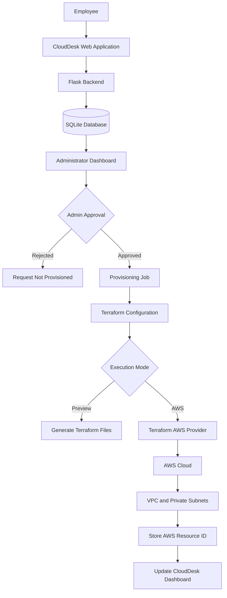
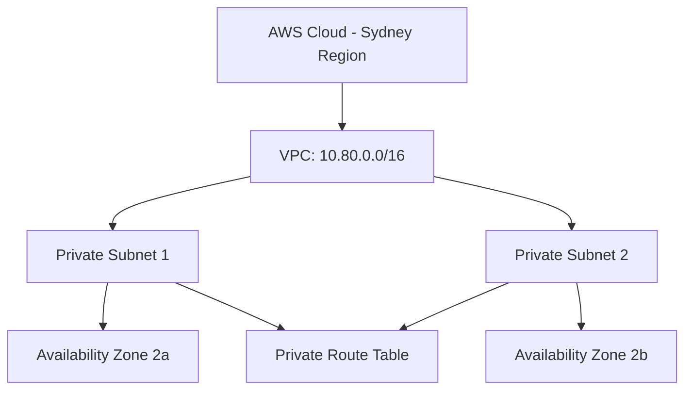

# CloudDesk — Automated Cloud Service Request Management

CloudDesk is a cloud-based service request management application developed using Python, Flask, SQLAlchemy, Terraform, and AWS.

The platform allows employees to submit service requests and administrators to review, assign, and approve them. For AWS VPC requests, administrator approval automatically triggers Terraform to provision cloud infrastructure.

The application tracks provisioning status and stores the AWS-generated VPC ID.

> **Project Status:** Successfully tested automatic AWS VPC provisioning in the Asia Pacific (Sydney) Region using Terraform.

---

## Tech Stack

| Category | Technologies |
|----------|--------------|
| Programming Language | Python |
| Backend | Flask |
| Database | SQLite |
| ORM | SQLAlchemy |
| Frontend | HTML, CSS, Jinja2 |
| Infrastructure as Code | Terraform |
| Cloud Platform | Amazon Web Services (AWS) |
| AWS Services | VPC, Subnets, Route Tables, IAM |
| Authentication | Flask-Login, Flask-WTF |
| Testing | Pytest |
| Development Tools | VS Code, Git, GitHub, AWS CLI |

Additional infrastructure configurations are available for EC2, RDS MySQL, CloudWatch, and SNS.

These configurations are separate from the successfully tested automated VPC provisioning workflow.

---

## Project Overview

In many organizations, employees request IT services or cloud infrastructure through emails, messages, or manual ticketing systems.

These processes can become difficult to track and may require administrators to manually create infrastructure resources.

CloudDesk addresses this problem by combining a service request management system with automated AWS infrastructure provisioning.

### Objectives

- Centralize employee service requests.
- Implement role-based access for employees and administrators.
- Automate request assignment and status tracking.
- Enable administrator-approved AWS resource provisioning.
- Integrate Terraform with a Flask application.
- Track provisioning results and AWS resource identifiers.
- Reduce manual infrastructure provisioning steps.

---

## Key Features

### 1. User Authentication

- Employee registration and login.
- Administrator login.
- Password hashing.
- Session management.
- Role-based access control.
- CSRF protection.

### 2. Service Request Management

Employees can:

- Create new service requests.
- Select request categories.
- Set request priorities.
- View their submitted tickets.
- Track request statuses.
- Add comments and view activity history.

Administrators can:

- View all service requests.
- Assign requests to administrators.
- Update priorities and statuses.
- Review request histories.
- Approve AWS infrastructure requests.
- Monitor infrastructure provisioning.

### 3. Automated AWS VPC Provisioning

CloudDesk integrates Terraform into its administrator approval workflow.

When an employee submits an AWS VPC request:

1. Flask validates the request.
2. SQLAlchemy stores the request in SQLite.
3. The administrator reviews the request.
4. The administrator approves the requested infrastructure.
5. Flask creates a Terraform provisioning job.
6. Terraform generates an infrastructure execution plan.
7. Terraform communicates with AWS using the AWS Provider.
8. AWS provisions the requested VPC and networking resources.
9. CloudDesk stores the AWS-generated VPC ID.
10. The provisioning status is updated in the dashboard.

### 4. Provisioning Modes

CloudDesk supports two provisioning modes.

#### Preview Mode

```env
PROVISIONING_MODE=preview
```

- Generates Terraform configuration files.
- Does not create AWS resources.
- Allows administrators to review the infrastructure configuration.
- Displays the status `Preview Ready`.

#### AWS Live Mode

```env
PROVISIONING_MODE=aws
PROVISIONING_REGION=ap-southeast-2
AUTO_RUN_PROVISIONING=true
ENABLE_AWS_PROVISIONING=I_UNDERSTAND_AWS_CHARGES
```

- Executes Terraform after administrator approval.
- Creates actual AWS infrastructure.
- Tracks provisioning execution.
- Records the AWS VPC ID.
- Displays success or failure status.

Live AWS provisioning requires valid AWS credentials and appropriate permissions.

---

## System Architecture



### Component Responsibilities

| Component | Responsibility |
|-----------|----------------|
| Frontend | Employee and administrator interface |
| Flask | Handles requests, authentication, approvals, and provisioning workflows |
| SQLAlchemy | Performs database operations through Python models |
| SQLite | Stores users, service requests, statuses, and provisioning records |
| Terraform | Defines and provisions cloud infrastructure |
| AWS Provider | Connects Terraform to AWS APIs |
| AWS VPC | Provides an isolated virtual network |
| AWS CLI | Authenticates and verifies AWS access |

---

## AWS Infrastructure Provisioned

Each approved VPC request creates the following Terraform-managed resources:

| Resource | Quantity |
|----------|----------|
| AWS VPC | 1 |
| Private Subnets | 2 |
| Private Route Table | 1 |
| Route Table Associations | 2 |
| Total | 6 |

### Example VPC Configuration

```text
AWS Region: ap-southeast-2

VPC CIDR:
10.80.0.0/16

Private Subnet 1:
10.80.1.0/24
Availability Zone: ap-southeast-2a

Private Subnet 2:
10.80.2.0/24
Availability Zone: ap-southeast-2b
```

### Networking Architecture



The generated infrastructure uses two private subnets across separate Availability Zones.

The ticket-specific configuration does not create an Internet Gateway, NAT Gateway, EC2 instance, or RDS database.

---

## Project Structure

```text
CloudDesk_v2/
│
├── app/
│   ├── __init__.py
│   ├── models.py
│   ├── forms.py
│   ├── routes.py
│   ├── provisioning.py
│   ├── templates/
│   └── static/
│
├── provisioning/
│   └── aws-vpc/
│       └── main.tf
│
├── infra/
│   └── main.tf
│
├── instance/
│   ├── cloud_desk.db
│   └── provisioning/
│
├── scripts/
│
├── docs/
│
├── tests/
│
├── requirements.txt
├── requirements-dev.txt
├── START_WINDOWS.bat
├── .env.example
├── Dockerfile
└── wsgi.py
```

The `instance` directory contains local application data and Terraform working files. It should not be committed to GitHub.

---

## Local Installation

### Prerequisites

Install:

- Python 3.11 or 3.12
- Git
- VS Code or another editor

For live AWS provisioning, also install:

- Terraform CLI
- AWS CLI
- AWS account with appropriate permissions

### Step 1: Clone Repository

```bash
git clone https://github.com/ManikaR26/cloud-desk.git
```

```bash
cd cloud-desk
```

Make sure you are using the updated CloudDesk v2 source code containing the Terraform automation feature.

### Step 2: Install Dependencies

Create a virtual environment:

```bash
python -m venv .venv
```

Activate it on Windows:

```cmd
.venv\Scripts\activate
```

Install dependencies:

```bash
pip install -r requirements-dev.txt
```

### Step 3: Configure Environment Variables

Create a `.env` file in the project root.

Example configuration:

```env
SECRET_KEY=GENERATE_A_PRIVATE_RANDOM_SECRET
DATABASE_URL=sqlite:///cloud_desk.db
APP_ENV=development
COOKIE_SECURE=false

PROVISIONING_MODE=preview
PROVISIONING_REGION=ap-southeast-2
AUTO_RUN_PROVISIONING=true
```

Never commit your actual `.env` file or AWS credentials to GitHub.

### Step 4: Start CloudDesk

On Windows, use the included startup script:

```cmd
START_WINDOWS.bat
```

The script performs local setup and starts the Flask development server.

Expected output:

```text
* Serving Flask app 'wsgi'
* Running on http://127.0.0.1:5000
```

Open:

http://127.0.0.1:5000

---

## Configure AWS Authentication

For live infrastructure provisioning, configure an authenticated AWS CLI profile.

### Step 1: Authenticate

```cmd
aws login --profile clouddesk --region ap-southeast-2
```

Complete the browser-based AWS authentication.

### Step 2: Configure Region

```cmd
aws configure set region ap-southeast-2 --profile clouddesk
```

### Step 3: Verify AWS Identity

```cmd
aws sts get-caller-identity --profile clouddesk
```

This retrieves the AWS account and authenticated identity information.

### Step 4: Configure Terraform Credentials

If Terraform cannot directly consume the AWS CLI login credentials, configure a credential-process profile:

```cmd
aws configure set credential_process "aws configure export-credentials --profile clouddesk --format process" --profile clouddesk-terraform
```

```cmd
aws configure set region ap-southeast-2 --profile clouddesk-terraform
```

Verify:

```cmd
aws sts get-caller-identity --profile clouddesk-terraform
```

Select this profile before starting CloudDesk:

```cmd
set "AWS_PROFILE=clouddesk-terraform"
```

Terraform can now request temporary credentials through the configured AWS CLI profile.

---

## Terraform Workflow

Terraform uses Infrastructure as Code to manage AWS resources.

### 1. Initialize

```bash
terraform init
```

Initializes the Terraform working directory and installs required provider plugins.

### 2. Validate

```bash
terraform validate
```

Checks whether the Terraform configuration is syntactically and structurally valid.

### 3. Plan

```bash
terraform plan
```

Previews infrastructure changes before execution.

Example output from the verified VPC configuration:

```text
Plan: 6 to add, 0 to change, 0 to destroy.
```

### 4. Apply

```bash
terraform apply
```

Provisions the defined infrastructure after confirmation.

In CloudDesk's live automation workflow, Terraform is executed by the provisioning backend after administrator approval.

Manual `terraform apply` is not necessary for the normal automated approval workflow.

---

## Verified AWS Deployment

The automated VPC provisioning workflow was successfully tested on October 26, 2026.

### Test Configuration

```text
Ticket ID: REQ-0004

AWS Region:
ap-southeast-2

VPC CIDR:
10.80.0.0/16

Provisioning Mode:
AWS Live
```

### Result

```text
Provisioning Status: Succeeded

VPC ID:
vpc-03d4cd3a06d1009c7

VPC State:
Available
```

### Verification

The provisioned VPC was independently verified through:

AWS Management Console → VPC → Your VPCs

The successfully created VPC demonstrated the complete workflow from employee request to real AWS infrastructure provisioning.

**Note:** This verifies Terraform-based AWS VPC creation. It does not mean the Flask web application itself has been deployed to EC2.

---

## Database Design

CloudDesk uses SQLite for local data storage and SQLAlchemy as its Object-Relational Mapping (ORM) library.

The database supports:

- User accounts
- Role-based permissions
- Service requests
- Ticket assignments
- Ticket statuses
- Comments
- Activity history
- Infrastructure provisioning jobs
- AWS resource identifiers

### Example SQLAlchemy Operation

```python
ticket = Ticket(
    title="AWS VPC Request",
    status="Open",
    user_id=2
)

db.session.add(ticket)
db.session.commit()
```

SQLAlchemy translates ORM operations into SQL statements executed by the configured database engine.

MySQL is supported through separate application and AWS hosting configurations, but SQLite was used for the verified local workflow.

---

## Security Features

CloudDesk includes:

- Password hashing.
- Role-based access control.
- Administrator-only infrastructure approval.
- CSRF protection.
- Session-based authentication.
- Input validation.
- Login throttling.
- Security headers.
- Separate Terraform working directories for requests.
- AWS authentication using temporary credentials.
- Preview mode to avoid unnecessary infrastructure provisioning.

AWS credentials and Terraform state files must be stored securely and excluded from version control.

For production use, the provisioning identity should have restricted IAM permissions.

---

## Testing

The upgraded CloudDesk application passed 16 automated local tests covering application behavior and provisioning workflows.

Run the test suite:

```cmd
.venv\Scripts\python.exe -m pytest -q
```

### Additional Manual Testing

The following workflow was tested:

1. Employee account login.
2. Creation of an AWS VPC request.
3. Administrator assignment and approval.
4. Terraform provisioning job execution.
5. AWS authentication and provider initialization.
6. Live AWS infrastructure creation.
7. Provisioning status tracking.
8. AWS VPC verification through the AWS Console.

---

## Troubleshooting

During implementation, AWS provisioning initially failed because Terraform could not access valid AWS credentials.

The error included:

```text
Error: No valid credential sources found
```

The issue was resolved by configuring an AWS CLI credential-process profile and verifying Terraform authentication.

Another issue involved insufficient local disk space during provider installation and AWS authentication cache operations.

Terraform's temporary working directory was moved to a drive with adequate storage.

These issues were resolved before the successful live VPC provisioning test.

---

## Current Limitations

CloudDesk is designed as a cloud engineering portfolio and learning project.

Current limitations include:

- AWS IAM access is not automatically granted to employees.
- Employee email notifications are not implemented.
- Automated provisioning currently focuses on AWS VPC resources.
- Provisioning jobs use a local background execution mechanism rather than a durable production job queue.
- Terraform state is stored locally.
- The complete EC2 and RDS application-hosting architecture has not been validated end-to-end.
- Failed provisioning jobs require administrator troubleshooting rather than automatic retries.

---

## Future Enhancements

- Employee notifications after infrastructure creation.
- Restricted AWS IAM access provisioning.
- Automated infrastructure deletion with administrator approval.
- Remote Terraform state storage and locking.
- Dedicated background job processing.
- Additional AWS resources such as EC2 and S3.
- CloudWatch-based provisioning monitoring.
- Automated cloud integration tests.

---

## Project Outcome

CloudDesk demonstrates the integration of backend development, database management, cloud infrastructure, and Infrastructure as Code.

The project successfully implements:

- A Flask-based service request management application.
- Role-based employee and administrator workflows.
- SQLAlchemy-based database management.
- Admin-approved Terraform automation.
- Real AWS VPC provisioning.
- Infrastructure execution status tracking.
- AWS resource verification.

The successful AWS VPC deployment confirms that the application can automatically provision cloud networking infrastructure after administrator approval.

---

## Author

**Manika Rattan**

B.E. Computer Science and Engineering  
Thapar Institute of Engineering & Technology

GitHub: [ManikaR26](https://github.com/ManikaR26)

---

**CloudDesk — From Employee Service Requests to Automated AWS Infrastructure Provisioning.**
